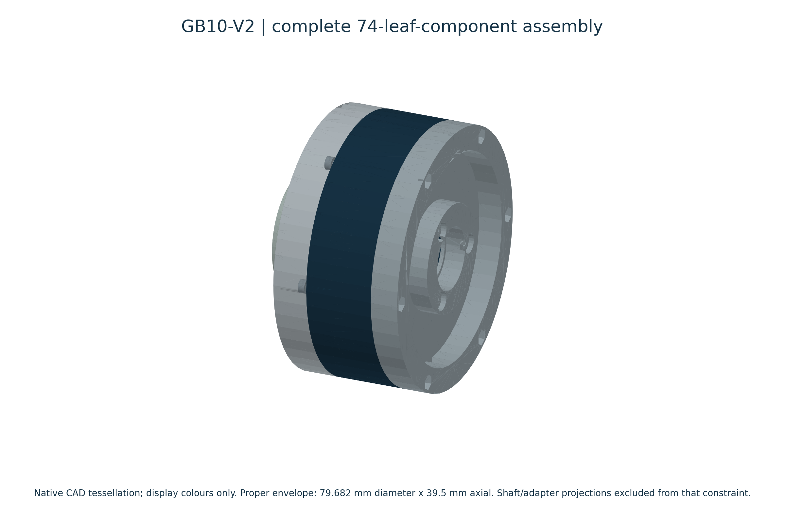

# GB10-V2 | engineering evidence case study

**A fixed-ring, sun-input, carrier-output 10:1 helical planetary gearbox investigated against an 80 mm diameter x 40 mm gearbox-body thickness limit using native CAD measurements, independent Python mechanics and linear-static FEA.**

**Final decision: retain the original output core.** The R0.20/R0.35 mm mouth fillets increased matched predicted peak stress from 15.1567 MPa to 15.5914/15.6129 MPa at hypothetical 0.15 N m. Neither met the provisional 5% improvement criterion. This is a negative geometry-comparison result, not an optimization success or torque rating.



Native geometry; 74 leaf components. Static gearbox-body envelope 79.682 mm diameter x 39.5 mm with documented projection exclusions. No fabricated hardware or bearing internals are implied.

## Read the investigation

- [Accessible local case study](index.html) or [Markdown case study](CASE_STUDY.md)
- [Full engineering report](docs/FULL_ENGINEERING_REPORT.pdf) and [technical summary](docs/TECHNICAL_SUMMARY.pdf)
- [Requirements / verification](docs/REQUIREMENTS_AND_VERIFICATION.md) and [machine-readable matrix](results/requirements_verification_matrix.csv)
- [Calculation methodology](docs/CALCULATION_METHODOLOGY.md), [simulation methodology](docs/SIMULATION_METHODOLOGY.md), [negative results](docs/NEGATIVE_RESULTS.md)
- [Matched candidate table](results/candidate_comparison.csv), [native stress field](evidence/baseline_bore_surface.npz), [figure index/captions](figures/FIGURE_INDEX.json)
- [Limitations](docs/LIMITATIONS.md), [reproduction](REPRODUCIBILITY.md), [source/attribution](SOURCES.md)
- [Website integration content](website/INTEGRATION.md)

## Reproduce the public calculation package

```sh
python -m pip install -r calculations/requirements.txt
python -B calculations/tests/run_tests.py
python -B calculations/reproduce.py
python -B calculations/check_publication.py
```

The mathematical suite has 62 tests. Public replay checks equations and selected archived values; it does not open SolidWorks, rerun native FEA or access the original workspace. Native reproduction needs separately retained licensed software and CAD/study archives. No CAD, commercial API bindings, CWR archives, vendor graphics, credentials or third-party binaries are bundled.

## Claim boundary and release status

CAD observations, analytical predictions, simulation results and unknowns are labelled separately. No physical testing, measured efficiency, actual bearing life, hardware torque capacity or validated operating envelope is claimed. The original is retained as a reference design, not a qualified gearbox. See the failed/open checks before quoting a numerical result.

Owner-authorized GitHub release: [GB10-V2-PORTFOLIO-V1.0](https://github.com/SriramNavi/10-1-Helical-Planetary-Single-Stage-Gearbox/releases/tag/GB10-V2-PORTFOLIO-V1.0). Public code is MIT; engineering documentation/figures are CC BY 4.0. Private native CAD and FEA/solver archives are excluded and remain all rights reserved. No live portfolio website deployment is included. [License scope](LICENSE_SCOPE.md).

## Licenses and attribution

Copyright (c) 2026 SriramNavi. [MIT source code](LICENSE-MIT.txt); [CC BY 4.0 documentation and figures](LICENSE-CC-BY-4.0.md). [Scope](LICENSE_SCOPE.md) and [attribution](ATTRIBUTION.md). Third-party materials retain their own licenses.
