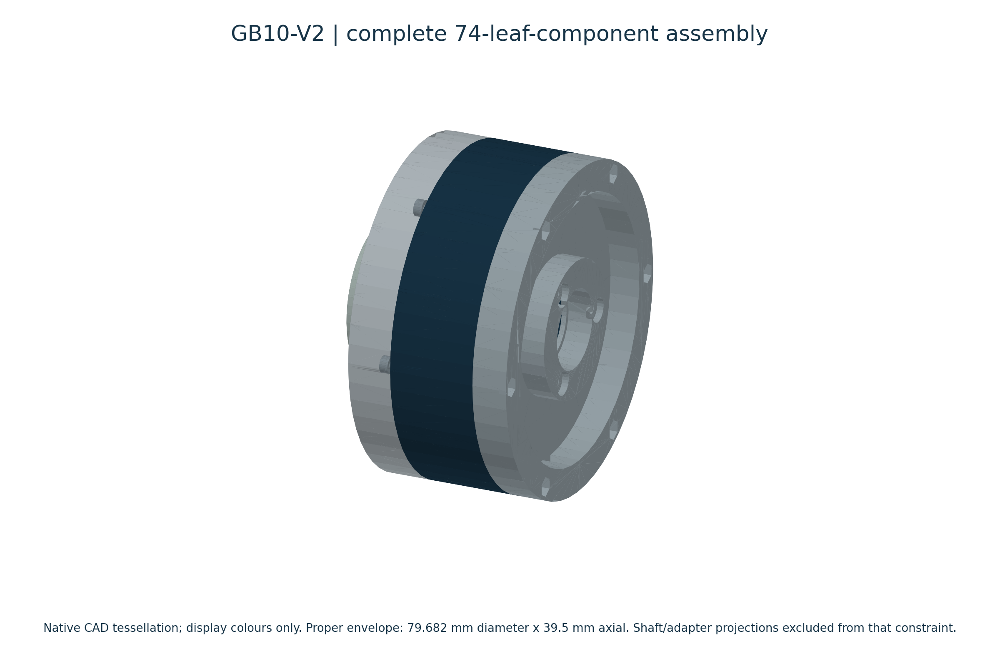
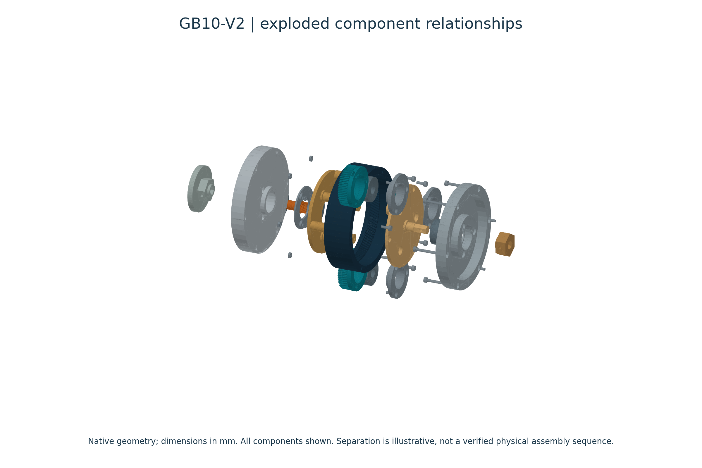
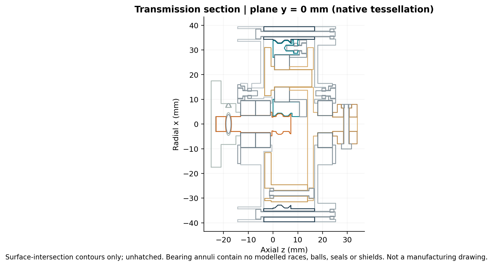
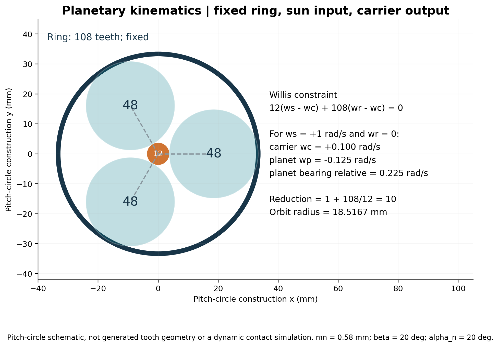
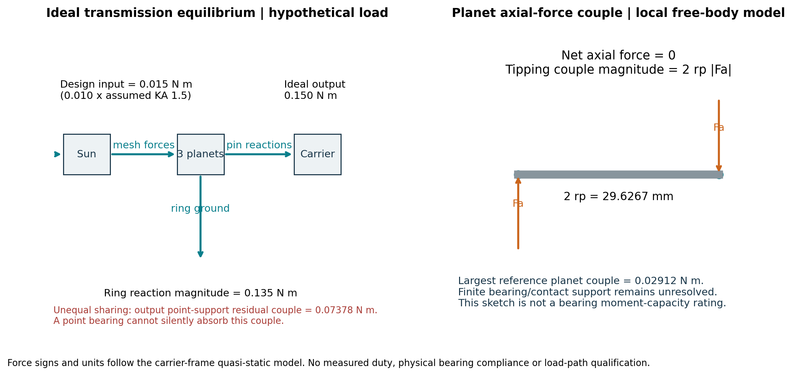
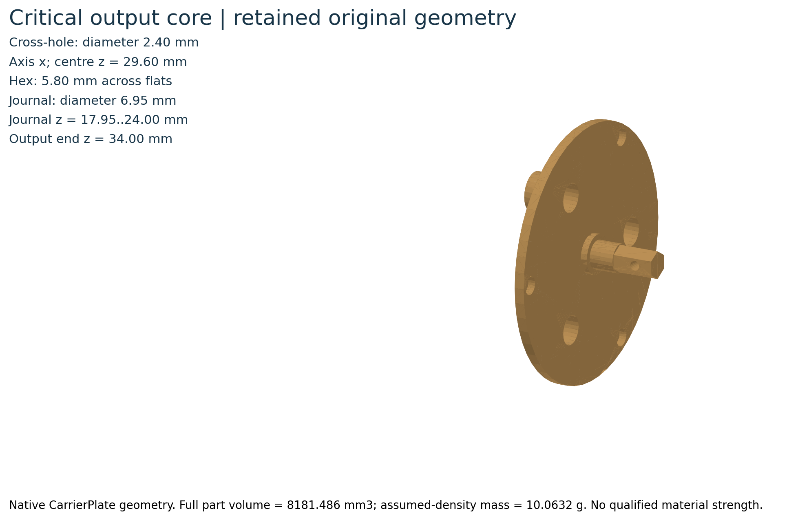
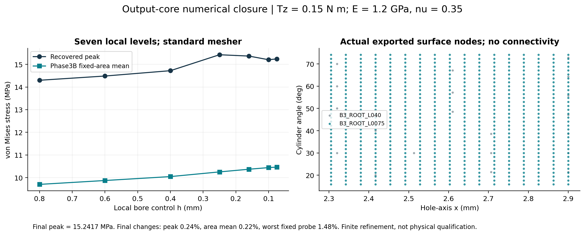
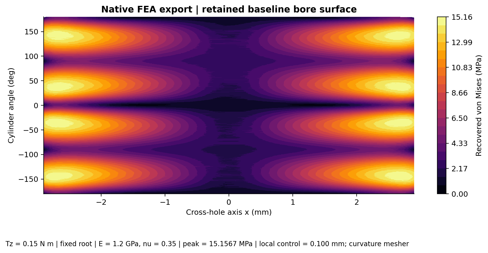
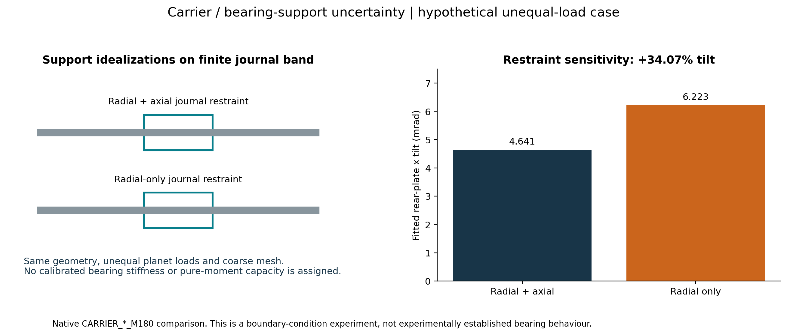
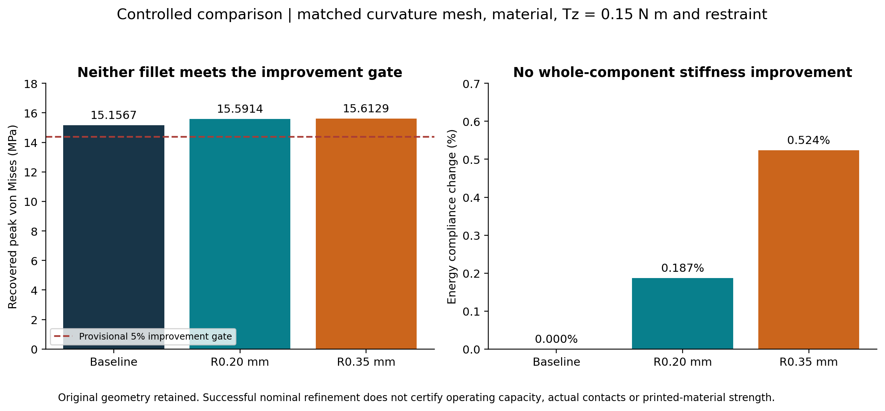

# GB10-V2: a compact 10:1 helical planetary gearbox

**Multidisciplinary Robotics / Mechatronics R&D Engineer**

## 1. Project overview

GB10-V2 is a standalone PLA demonstrator with a fixed ring, sun input and carrier output. The investigation asked whether its existing geometry and load paths justified an operating claim within an 80 mm diameter x 40 mm gearbox-body thickness constraint. Native CAD measurements, independent Python mechanics and linear-static FEA supported conditional component comparisons; they did not establish an operating rating.

The final decision was to **retain the original output-core geometry**. Two hole-mouth fillets increased the predicted peak stress under matched hypothetical loading. The useful result was a defensible decision supported by measured geometry and numerical checks, rather than an assumed improvement from adding a fillet.

**Evidence boundary:** the project is CAD-derived, calculated and simulated. No gearbox was fabricated or physically tested in this investigation. No certified torque capacity, safe operating envelope, measured efficiency or hardware durability is established.



*Actual native part tessellation with frozen-audit component transforms. Six bearing envelopes; no bearing internals or physical build are implied. Source: P0 native audit + Phase5 read-only tessellation/transform check.*


## 2. Engineering problem

A compact reducer can satisfy nominal packaging and ratio constraints while retaining unresolved structural and support limitations. GB10-V2 uses a small sun gear, three large planets, helical meshes, six single-row bearing envelopes and a cross-drilled hex output core. Those features create interacting tooth-force, thrust, pin-bending, bearing-support and notch-stress questions.

The engineering question was therefore: **what can the existing design actually support as a technical claim, and which uncertainties govern the next decision?** Historical CAD validation was audited before using it. All 23 native files differed from the old manifest, so its old certification label was not transferred to the current files. A frozen Candidate F snapshot became the traceable baseline. [P0]

## 3. Design requirements and constraints

The standalone gearbox constraints were preserved throughout the investigation.

| Item | Constraint or observation | Evidence |
| --- | --- | --- |
| Topology | 12 / 48 / 108 teeth; three planets | Native tooth-pattern readback |
| Reduction | 10:1 nominal | Independent kinematic calculation |
| Gearbox-body diameter | <=80 mm; static bound 79.681688 mm | Native support-point audit |
| Gearbox-body thickness | <=40 mm; observed 39.5 mm | Native audit, documented exclusions |
| Bearings | Six nominal 7 x 19 x 6 mm envelopes | Native annular geometry |
| Material architecture | PLA demonstrator | Design intent; no qualified strength |
| Operating duty | Torque, speed, duration and life unknown | No motor or duty invented |

The gearbox-body envelope is the static size after the documented shaft/adapter exclusions, not the size of the complete assembly. Body thickness is 39.5 mm; the full audited axial span including projections is 59 mm. Archived figures use "proper envelope" for this same bounded body measurement. Packaging was checked in a bounded static pose, not across every tolerance or motion condition. A separate preliminary robot application had a 70 mm joint target; that target was not silently substituted for GB10's 80 mm constraint. No robot-actuator compatibility is claimed. [P0, P1]

## 4. Transmission architecture

The ring is fixed, the sun is the input and the carrier is the output. Two input bearings support the sun shaft; each of the three planets has one bearing envelope; one output bearing envelope supports the carrier/output region.

Bearing functions differ even when the nominal dimensions match. The adjacent input bearings are not qualified as a matched duplex pair. The output support was not assigned an invented pure-moment capacity. Bearing CAD is an annulus: separate races, rolling elements, shields, seals and internal clearances are absent. Stored assembly mates are not validated structural fixtures. [P0, P3]

The exploded illustration preserves the measured part shapes and frozen component transforms before applying display-only separation. It explains component relationships; it does not certify an assembly sequence, insertion force or physical fit.



*Actual native part tessellation with frozen-audit component transforms. Exploded offsets affect only this illustration; CAD component positions remain unchanged. Source: P0 native audit + Phase5 read-only tessellation/transform check.*




*Axial section of native tessellated surfaces at y=0 mm. 72 contour paths; no bearing internals fabricated. Full projections shown; the gearbox-body-envelope exclusion is separate. Source: P0 native CAD geometry; Phase5 read-only extraction.*


## 5. Mechanical design methodology

The preserved Candidate F geometry uses normal module 0.58 mm, normal pressure angle 20 deg, helix angle 20 deg and face width 7.2 mm. The recorded profile uses zero shift, 0.8-module addendum, 1.2-module dedendum and a 0.15 mm circular root blend. Those custom stub/root details are not a generated cutter trochoid or a complete standardized gear rating.

The work separated design intent, native measurement, simplified mechanics and numerical evidence. Original CAD was kept read-only. Structural work used independently remapped copies; the initial Phase 3 copy contained 23 documents and 37 remapped reference edges, with 79 live component-node references checked inside its workspace. Local Phase 4A candidates retained clean editable fillet features and separate BRep-equivalent analysis derivatives. [P0, P3, P4A]

For publication, native cached tessellation was read without setters, rebuilds or saves. All 74 leaf-component transforms matched the frozen audit and original dirty flags remained unchanged. Display colours, section cuts and exploded offsets are explanatory render operations, not a design revision.

## 6. Kinematic and geometric calculations

The independent Python model uses the Willis constraint:

`zs*(ws-wc) + zr*(wr-wc) = 0`

With the ring fixed, `i = ws/wc = 1 + zr/zs = 10`. For input `ws=+1 rad/s`, the carrier is `+0.100 rad/s`, the planet is `-0.125 rad/s` in the fixed frame, and planet rotation relative to its carrier is `-0.225 rad/s`. The last quantity governs the modeled planet-bearing relative speed.

Normal/transverse conversion uses `mt=mn/cos(beta)` and `alpha_t=atan(tan(alpha_n)/cos(beta))`. Pitch diameters are 7.406677, 29.626709 and 66.660096 mm. Both mesh center-distance relations give an orbit radius of 18.516693 mm. Equal-spacing phasing gives `(108+12)/3=40`, an integer.

Calculated transverse contact ratios are 1.200479 for sun/planet and 1.397676 for planet/ring; overlap ratio is 1.351470. No overlap-based strength credit was assumed. These are geometric predictions, not proof of loaded contact, manufacturing accuracy or dynamic torque transmission. The analytical package passed 62 tests, including independent linear-equation kinematics and limit cases. [P2]



*Calculated pitch-circle construction using the verified tooth counts and documented helical inputs. Signed velocities are ideal kinematics, not dynamic validation. Source: P0 tooth counts + P2 analytical equations/inputs.*


## 7. Analytical force and stress modeling

The reference structural screen starts from an **assumed** nominal input of 0.010 N m and application factor 1.5, giving design input 0.015 N m and ideal output 0.150 N m. Explicit planet fractions `[2/3, 1/6, 1/6]` give load-sharing factor `Kgamma=3*max(wi)=2` while preserving the applied torque.

For each branch, `Ft=Td*wi/rs`, `Fr=abs(Ft)*tan(alpha_t)` and `Fa=Ft*tan(beta)`. Opposing axial mesh forces can cancel on a planet while still producing a tipping couple. The largest reference planet couple is 0.02912 N m; unequal sharing leaves a 0.07378 N m output transverse couple about the declared support center. A point-support-only assumption cannot react that couple without another load path.

The simplified Lewis sun-root demand is 2.58646 MPa using an assumed form factor 0.25. The external pitch-point cylinder-contact surrogate gives 9.04453 MPa. These are demand estimates, not printed-PLA allowables or a complete ISO/AGMA rating. The output circular-core surrogate motivated further investigation, but its stress divided into the FEA peak is not a calibrated stress-concentration factor: geometry, gauge and loading idealizations differ.

Force/torque balance, Hertz pressure integration, beam-energy quadrature, dimensional scaling and power conservation were tested independently. The 1,944-point deterministic uncertainty grid is a set of assumed coordinates, not a probability distribution or a validated operating envelope. [P2, P3B]



*Independent force/moment equilibrium exposes a residual output support couple and a planet tipping couple despite zero net axial planet force. All loads are analytical hypotheses. Source: P2 statics.py and PHASE_2_ANALYTICAL_REPORT.*


## 8. Structural FEA methodology

Phase 3 completed 24 native linear-static solves across eight load/restraint families, with three meshes per family. Phase 3B added nine successful solves for numerical closure. Phase 4A added 16 successful local-comparison solves. These counts are new solves per phase; exported equilibrium fields sometimes reuse earlier solves and must not be summed as independent experiments.

The structural hypothesis is homogeneous isotropic `E=1.2 GPa`, `nu=0.35`, density `1230 kg/m3`, with high-quality quadratic solid meshes. These are unqualified material assumptions; no yield/strength allowable is assigned. Soft springs, inertial relief and large-displacement options are disabled in the output studies.

The output comparison fixes the broad underside at z=13.9 mm and distributes `Tz=0.15 N m` over the full end face at z=34 mm. An alternative fixes three tie-hole barrels. Neither fixture represents calibrated bolt elasticity or real collar/hex contact. Actual torque transfer could enter through distributed hex contact differently. The carrier models use rigid end/foundation assumptions and a global bonded-contact hypothesis whose physical footprint and pilot-gap treatment remain unresolved.

Independent reactions include `sum(r cross F + M)` about a consistent origin. Phase 3 checked nine exported meshes; finer fields without full exports remained explicitly unverified. Phase 3B checked 11 output fields including reused data; Phase 4A checked 17 including one frozen field. Zero solver return codes alone were not accepted as verification. [P3, P3B, P4A]



*Native CAD-derived CarrierPlate/output-core representation. Dimensions from native cylindrical/planar readback. Colour is explanatory; not a stress map. Source: P3 OUTPUT_GEOMETRY_READBACK; P4A GEOMETRY_VERIFICATION; Phase5 native tessellation.*


## 9. Mesh-convergence investigation

The initial Phase 3 output peak changed enough to fail the provisional 5% final-step criterion in four families. The highest reported Phase 3 output peak, 14.35 MPa, was not treated as an upper bound.

Phase 3B used seven local bore controls from 0.800 to 0.075 mm, retaining a separate global mesh. The finest recovered peak was **15.241717 MPa**. Final refinement changes were approximately 0.24% for peak, 0.22% for fixed-area mean and 1.48% for the worst consistent physical probe. Displacement, strain energy, quadrature and reaction balance were evaluated separately. Earlier area/probe failures prompted documented extensions; displacement convergence alone did not close the stress question.

Phase 4A's matched curvature-mesh baseline is **15.156654 MPa**, 0.558% below the independently reproduced standard-mesh baseline. This is a protocol crosscheck, not an optimization gain. Candidate refinement uses local face controls 0.160, 0.125 and 0.100 mm. The final native readback reports a common 0.005 mm minimum-size setting despite the pre-mesh h/2 request. That requested-versus-realized discrepancy is retained and reconciled; actual smallest element-edge length was not measured. The realized local-control series is not described as an h/2-minimum series. [P3B, P4A]



*Seven-level Phase3B local study. Native surface nodes are shown as points, not invented element edges. The Phase3B mean patch differs from the retained common patch used in Phase4A. Source: Phase3B CONVERGENCE_METRICS; REFINEMENT_CHANGES; native HOLE_SURFACE fields.*




*Native SolidWorks Simulation nodal stresses, displayed with linear interpolation on the unrolled cylindrical surface; this is not a native UI screenshot. Legend in MPa. No material failure threshold is assigned. Source: Phase4A A4F_Baseline_T_H100_CV/STUDY_RECORD.json and HOLE_SURFACE.npz.*


## 10. Bearing-support sensitivity

A controlled coarse carrier comparison removed axial restraint from the finite journal band while retaining radial support. Fitted rear-plate x tilt increased from 0.0046414 to 0.0062227 rad, or **34.07%**. Native reactions show the imposed transverse moment shifting from a combination of radial and axial force couples into radial-force couples.

This is evidence that the boundary condition matters. It is not a measured bearing stiffness, a demonstrated single-bearing moment capacity or a convergence-qualified global bearing model. Attempts to prepare explicit native separated support bands failed; no native band solve is claimed. Analytical support-spacing and unknown-stiffness sweeps remain conditional.

Moment reconciliation used `Mcenter=Morigin-rcenter cross R`; comparing moments about different origins would have produced a false disagreement. Matched-gauge output twist was also compared without tuning E. A 16.05 mm shaft gauge gave 0.0417761 rad at the hypothetical torque, equivalent to 3.59057 N m/rad for that component/gauge hypothesis. Complete gearbox stiffness remains unknown. [P3, P3B]



*Actual coarse native response: 4.6414 to 6.2227 mrad fitted x tilt (+34.07%). Constraint sketch is explanatory, not an actual bearing contact model. Source: Phase3 CARRIER_BOUNDARY_RESPONSE; Phase3B reaction reconciliation.*


## 11. Output-core geometry optimization

Phase 4A tested a narrow hypothesis: could rounding the two cross-hole mouths reduce the output-core stress concentration without changing the journal, hole throat, hex envelope or package?

The baseline has a 2.40 mm cross-hole through an AF 5.80 mm output hex. C1 adds R0.20 mm mouth fillets and C2 adds R0.35 mm fillets. Native checks confirmed one solid, unchanged bounds, throat/axis/center, journal and end plane. Both candidates are material-removing subsets of the baseline and cannot enlarge its static envelope. Reinforcing bosses, bore filling and hole relocation were screened out because they change constrained mating/retaining interfaces.

Straight bore land decreases from 5.80 mm to 5.40/5.10 mm. Nominal total hex-flat area retention is 98.297%/96.848%. These are geometry observations; neither proves cross-fastener retention strength, contact pressure or print realization. The 63-case analytical tolerance screen does not establish tolerance-dependent stress ranking or qualified manufacturing capability. [P4A]

## 12. Comparison of candidate designs

All three fine nominal cases use the same hypothetical 0.15 N m end torque, material assumptions, fixed-root restraint and matched curvature protocol.

| Geometry | Peak stress (MPa) | Peak change | Energy compliance change | Decision |
| --- | --- | --- | --- | --- |
| Baseline | 15.1567 | Reference | Reference | Retain reference |
| R0.20 mm | 15.5914 | +2.868% | +0.187% | No demonstrated improvement |
| R0.35 mm | 15.6129 | +3.010% | +0.524% | No demonstrated improvement |

Both candidates pass the declared final-step criteria: peak <=5% change, common-area mean <=2%, worst fixed probe <=5%, displacement <=2% and energy <=2%. Final peak changes are 0.268% and 0.180%; worst fixed-probe changes are 0.939% and 1.288%. Passing finite refinement does not qualify material or contact assumptions.

Whole-component energy stiffness is `T^2/(2U)`: 3.4615, 3.4550 and 3.4435 N m/rad. A fitted shorter shaft gauge is a different proxy and must not be substituted for this energy measure. Mass changes at the assumed density are below 0.006% and provide no meaningful optimization argument.

One-level support and combined-bending screens also leave both candidates above the baseline peak. The tiny C1/C2 ordering reverses under combined bending and is below a defensible robustness distinction. Alternative-case stress convergence and tolerance-dependent stress ranking remain unverified. [P4A]



*Matched native results: 15.1567,15.5914,15.6129 MPa. Energy compliance increases 0.187%/0.524%; these small changes are conditional proxies, not measured stiffness. Source: Phase4A PARAMETRIC_COMPARISON and mesh-convergence evidence.*


## 13. Engineering decision and reasoning

**Retain the original output core.** Neither candidate satisfies the provisional requirement for at least 5% lower peak stress. Both increase the matched global peak and common retained-bore mean. The small compliance and mass differences do not compensate for that failed objective, and the mouth fillets reduce bore land and flat area.

The supported interpretation is that the tested mouth rounding removes material near an already stressed interior-hole region and shifts the hotspot. It is not a universal conclusion that fillets increase stress. The decision applies only to these local candidates, loads, restraints and numerical evidence.

The retained baseline is the reference design, not a qualified operating gearbox. No modified geometry was released into the authoritative assembly. The investigation stopped after the approved component-level study. [P4A]

## 14. Limitations and unverified claims

- **Physical performance:** no fabrication, measured fit, backlash, stiffness, efficiency, thermal test, endurance test or torque capacity is established.
- **Material:** printed anisotropy, interlayer failure, creep, fatigue, wear, temperature dependence and process scatter are unqualified.
- **Bearings and contacts:** actual maker identity, load factors, life, clearance, moment transfer, race/retainer stiffness, bolt preload/slip and collar/hex load transfer remain unresolved.
- **Numerics:** finite refinement is conditional; alternative support/combined cases have one mesh each. Native separated-band preparation failed. Mesh-setting and solver-startup discrepancies are documented rather than hidden.
- **System scope:** the loss and heat models are parameterized. An illustrative loss calculation is not a measured efficiency map; deadband estimates are not assembled backlash. No motor, electronics, controller, balancing robot or dynamic actuator was validated here.
- **Provenance:** historical native certification was not inherited. An approved Phase 3 preservation exception changed one GEN intermediate and one MAS timestamp during Phase 3B preparation; native CAD, 24 CWR archives and exported engineering results remained intact. Later evidence retains the exception instead of resetting manifests.

Failed experiments remain part of the evidence: invalid assumed motoring points, a failed point-support-only load path, four initial output peak-convergence checks, unsuccessful support-band preparation, eight unusable Phase 4A attempts and the requested-versus-realized minimum mesh setting. These are not reported as physical component failures. [P0-P4A]

## 15. Future validation work

Future work requires a separately approved scope. A useful sequence is:

1. Establish an actual coincident torque-speed-duration use case, life requirement and acceptance limits.
2. Qualify the intended printed process/material and characterize temperature, creep and anisotropic response.
3. Identify actual bearings and a credible finite-width bearing/retainer/contact load path; establish capacity inputs before predicting life.
4. Revisit contact, fastener and load-application assumptions with independently verified reactions and appropriate numerical refinement.
5. Only after authorization, measure fit, backlash, torsional stiffness, losses, temperature and durability using controlled instrumentation and documented uncertainty.

No item in this future plan was executed by preparing the publication. No new optimization or FEA was performed in Phase 5.

## 16. Engineering competencies demonstrated

| Competency | Concrete evidence |
| --- | --- |
| Mechanical design | Native interface, packaging, bearing-seat and cross-hole interrogation; controlled editable candidates |
| Transmission engineering | Signed planetary kinematics, normal/transverse geometry, branch loads and ring reaction |
| Applied mathematics | Equilibrium, beam/torsion energy, Hertz/Lewis surrogates, dimensional and conservation tests |
| Structural analysis | Native linear-static studies with explicit restraints, materials and model limitations |
| Numerical verification | Local refinement, fixed physical probes, quadrature, reactions and analytical reconciliation |
| Engineering experimentation | Controlled computational changes to geometry, support and loading; negative results retained |
| Trade-off analysis | Peak stress, compliance, mass, bore land, mating area and manufacturing uncertainty considered together |
| Engineering software | Reproducible Python calculations, native-API automation, field postprocessing and provenance records |

For robotics and mechatronics teams, the transferable value is the ability to connect requirements, transmission mechanics, structural evidence and an honest design gate. The project demonstrates analysis and verification of a transmission component; it does not claim implemented controls, electronics or hardware-qualified robotic actuation.

# Technical appendices

# Calculation methodology

The portable package retains the Phase 2 numerical model, with a public runner that has no CAD import, proprietary API dependency, procurement path or source-workspace mutation. SI units are used internally; presentation tables may use mm, MPa and mrad.

## Geometry and kinematics

`mt=mn/cos(beta)`; `alpha_t=atan(tan(alpha_n)/cos(beta))`; `r=mt*z/2`.

`a=rs+rp=rr-rp`. The external path length is `sqrt(ra_s^2-rb_s^2)+sqrt(ra_p^2-rb_p^2)-a*sin(alpha_t)`; divide by `pi*mt*cos(alpha_t)` for the transverse contact ratio. The internal path uses the planet term minus the internal-ring tip term plus `a*sin(alpha_t)`. `eps_beta=b*abs(sin(beta))/(pi*mn)`. Stub/root assumptions are explicit; generated-root and loaded-contact qualification are absent.

`zs*(ws-wc)+zr*(wr-wc)=0`; `zp*(wp-wc)=-zs*(ws-wc)`.

## Forces and support equilibrium

`Td=KA*Tin`, `sum(wi)=1`, `Kgamma=N*max(wi)`; do not multiply every branch by Kgamma while preserving the same total torque. `Ft_i=Td*wi/rs`; `Fr_i=abs(Ft_i)*tan(alpha_t)`; `Fa_i=Ft_i*tan(beta)`.

For a planet, sun/ring tangential forces add, radial components oppose, axial components cancel in the ideal case, and axial forces leave a transverse couple `2*rp*Fa`. All force/couple vectors retain their reference points. Frame shifts use `M_B=M_A-r_AB cross F`. An unresolved couple is reported rather than assigned to an ideal point bearing.

## Simplified stress and compliance

Lewis demand: `sigma_F=Kface*abs(Ft)/(b*mn*Y)`; Y and face factors are hypotheses. No full ISO/JGMA/AGMA rating is claimed.

Isotropic pitch-point cylinder surrogate: `1/Eprime=sum((1-nu^2)/E)`, `1/Rprime=1/rho1 +/- 1/rho2`, `aH=sqrt(4*Fline*Rprime/(pi*b*Eprime))`, `p0=sqrt(Fline*Eprime/(pi*b*Rprime))`. The internal curvature uses subtraction. Skew contact, friction, roughness, wear and viscoelasticity are unresolved; the surrogate is not asserted conservative.

Circular sections: `I=pi*d^4/64`, `J=pi*d^4/32`, `sigma_b=32*M/(pi*d^3)`, `tau=16*T/(pi*d^3)`, `theta=T*L/(G*J)`. Short-member shear-energy terms remain assumptions; hole/hex geometry is not represented by an unnotched circular stress. Input compliance reflects to output as `Cs/i^2`.

## Power, clearance, life and uncertainty

Power balance separates nominal loss assumptions from design-multiplied force cases. Reference mesh eta=0.98 and bearing drag=1e-4 N m at nominal Tin=0.01 N m and input 10 rad/s predict 0.93661 efficiency; that is not an efficiency measurement or operating recommendation. The 216-point grid retains 36 infeasible assumed motoring points and 54 static cases with undefined efficiency.

Mesh-only full deadband is `(j_sp+j_pr)/(2*a)=0.010801065 rad`, or 0.618855 deg, using the two assumed 0.20 mm transverse clearances. Complete backlash remains unknown. Basic ball-bearing `L10=1e6*(C/P)^3` requires manufacturer factors and actual relative speed; actual bearing life is null. Thermal rise equations require unknown thermal resistance, heat capacity, allowable material temperature and duty.

The 1,944-point deterministic uncertainty grid is not a statistical confidence interval. Partial conditional component ceilings exclude unresolved gates and are never converted into a system torque rating. The public runner retains null system-capacity fields. Sixty-two mathematical tests and four archived-value comparisons verify software/model arithmetic, not hardware performance.


# Simulation methodology

## Scope and native preparation

Native SolidWorks Simulation 2025 static studies were executed in independent workspaces. The original assembly was never rebuilt or saved. Phase 3 remapped 23 native documents and checked 37 reference edges / 79 live component nodes. The exact commercial license SKU was not established; capability is supported by successful solves. Proprietary bindings, commercial binaries and native CAD/CWR archives are excluded from this public package.

## Loads, materials and restraints

The output model fixes the broad underside at z=13.9 mm and applies distributed end torque Tz=0.15 N m at z=34 mm. An alternative fixes the three tie-hole barrels. End loading does not reproduce actual hex/collar/fastener contact. Carrier models use two original solids, rigid end coupling and a finite journal foundation, with bonded-contact/load-transfer limitations. Radial-only support removes journal axial restraint; it does not identify a real bearing compliance.

Hypothetical isotropic E=1.2e9 Pa, nu=0.35 and density=1230 kg/m3 are assigned/read back. No qualified strength/yield allowable is assigned. Quadratic high-quality solid elements are used. Output soft springs, inertial relief and large-displacement options are disabled. Solver configuration/return codes, material readback, node/element counts, boundary node mapping and diagnostics remain in the private authoritative run records.

Phase 4A's combined end-wrench screen adds Mx=0.0704769466 and My=-0.0218382141 N m to Mz=0.15 N m. These Phase 2 overturning components are deliberately reassigned to the output end for sensitivity, not asserted to be a verified coincident application load. Alternative cases have one fine mesh and no independent convergence claim.

## Numerical verification

Reactions satisfy `sum(R)+sum(F)=0` and `sum(x cross R + Mnodal)+sum(Mapplied + r cross F)=0` about the same origin. Moment residual tolerance is 0.001 relative; zero-resultant-force cases use the declared characteristic force normalization. Native six-component stresses are independently recombined into von Mises. Displacement norms and relevant section rotations are checked where exported.

Phase 3B's seven-level local standard series resolves peak/area/probe trends. Phase 4A uses three local face-control levels per modified candidate: 0.160,0.125,0.100 mm, global maximum 1.2 mm. The pre-mesh requested minimum h/2 differs from the post-mesh API MinElementSize=0.005 mm in all 13 successful curvature cases. The exact API overwrite/interpretation behavior and actual minimum edge length remain unverified. Compare the realized common protocol; do not claim an h/2-minimum refinement sequence.

The Phase 4A common bore patch uses |x|=2.00..2.45 mm and radius 1.20 mm. Fixed probes use x=-2.25,0,+2.25 mm at angles 30,150,210,330 deg. This differs from the Phase 3B mouth patch because the latter is trimmed by candidate fillets. Mean/probe values from those patches are not interchangeable. Final-step criteria: peak 5%, area mean 2%, worst fixed probe 5%, displacement 2%, energy 2%. The finite criteria are not an asymptotic error estimate or proof that all singularities/contact artifacts are absent.

Whole-component energy stiffness T^2/(2U) applies to a pure-torque case. A fitted shaft gauge is a separate measure; combined-load energy is not relabelled pure torsion. Modulus was not tuned to force agreement.

## Failures and limits

Retained failures include four initial output peak-convergence failures; an unsupported remote setup; failed explicit-band preparation with zero band solves; two standard fine blend mesh return-8 cases; no-load startup diagnostics despite load readback; missing fresh-template material; and an invalid-LBC suppression diagnostic. A zero native return code with no usable result was not accepted. The precise intermittent startup cause remains unresolved. Native estimated error indicators and SVD text are not automatically interpreted as local stress error bounds or singularities.

Phase 3 has 24 successful solves but only nine independent exported-field equilibrium checks. Phase 3B has nine new solves and 11 checked fields including two reused; Phase 4A has 16 successful solves, eight unusable attempts and 17 checked fields including one reused. These are conditional simulations, not physical experiments. No torque capacity, fatigue limit, actual bearing life or thermal duty is established.


# Requirements and verification

B/D/P/U classifications remain separate. No unknown acceptance value is populated from a hypothetical screen.

| ID | Class | Requirement | Evidence / status |
| --- | --- | --- | --- |
| R01 | Verified baseline | Counts/topology | 12/48/108; 3 planets; fixed ring; PASS_NATIVE_OBSERVATION |
| R02 | Derived | Reduction ratio | 10:1 ideal fixed-ring relation; PASS_ANALYTICAL |
| R03 | Verified baseline | Proper static diameter <=80 mm | 79.681688 mm; pose/exclusions bounded; PASS_STATIC_ONLY |
| R04 | Verified baseline | Gearbox-body thickness <=40 mm | 39.5 mm; full projections 59 mm; PASS_STATIC_ONLY |
| R05 | Verified baseline | Six bearing envelopes | 7 x 19 x 6 mm; functions distinct; PASS_NOMINAL_ONLY |
| R06 | Unknown | Coincident torque-speed-duration/life | Not established; UNVERIFIED |
| R07 | Unknown | Qualified printed properties/allowables | E/nu/rho used only as hypotheses; UNVERIFIED |
| R08 | Derived | Force/torque/moment conservation | Explicit branches, reference points and residuals; PASS_MODEL_INVARIANTS |
| R09 | Derived | Output equilibrium in exported fields | P3:9; P3B:11 incl reuse; P4A:17 incl reuse; PASS_EXPORTED_FIELDS_ONLY |
| R10 | Provisional | Output peak/probe local refinement | Final P3B peak .24%; mean .22%; probe 1.48%; CONDITIONAL_PASS |
| R11 | Unknown | Bearing finite-width moment load path | Point model incomplete; actual compliance unknown; OPEN |
| R12 | Provisional | Support robustness | 34.07% carrier x-tilt sensitivity; CONDITIONAL_MODEL_COMPARISON |
| R13 | Provisional | Modified peak reduction >=5% | R0.20 +2.868%; R0.35 +3.010%; FAIL_IMPROVEMENT_GATE_BASELINE_RETAINED |
| R14 | Baseline/derived | Retain constrained candidate dimensions | Throat/journal/hex envelope retained; land reduced; PASS_NOMINAL_CONTACT_UNVERIFIED |
| R15 | Provisional | Compliance penalty <=2% | Energy penalties .187% / .524%; PASS_CONDITIONAL_PROXY |
| R16 | Provisional | Mass increase <=1% | Assumed-density mass decreases <.006%; PASS_NOMINAL_MODEL |
| R17 | Derived | Document realized mesh settings | Post-mesh minimum .005 mm versus requested h/2; DECLARED_DEVIATION_RECONCILED |
| R18 | Unknown | Tolerance-dependent structural ranking | 63 scalar geometry cases; no tolerance FEA; UNVERIFIED |
| R19 | Unknown | Complete backlash / stiffness | Mesh-only deadband and component proxies only; UNVERIFIED_SYSTEM |
| R20 | Unknown | Measured efficiency / continuous thermal duty | Loss/heat parameters unqualified; UNVERIFIED |
| R21 | Unknown | Physical validation / certified capacity | No hardware tests; no capacity rating; NOT_ESTABLISHED |
| R22 | Evidence integrity | Preserve earlier evidence | Approved GEN/MAS exception retained; 2548 files guarded; PASS_NO_NEW_EXCEPTION |
| R23 | Release gate | Public ownership/license approval | Owner confirmed rights; MIT code / CC BY 4.0 documentation and figures; APPROVED_FOR_PUBLIC_PACKAGE |


# Reproducibility

## Portable public replay

Use Python 3.11 or newer. From the publication root, install the pinned NumPy/SciPy versions in a local environment, then run:

```sh
python -m pip install -r calculations/requirements.txt
python -B calculations/tests/run_tests.py
python -B calculations/reproduce.py
```

The inherited mathematical suite contains 62 tests. The runner compares four selected analytical values with archived Phase 2 outputs and reconciles the retained-baseline decision against the selected native result table. It writes only `calculations/reproduced/`; the test runner writes `calculations/results/`. No SolidWorks installation, CAD opening, FEA, network request or source-project access is performed by these commands. The machine-readable reference inputs keep actual material/duty/operating limits null. The unrelated preliminary robot-application context was removed from the public input copy; the numerical model and test equations are unchanged.

The selected native tables can be inspected in `results/`. The baseline bore surface is included as a numeric NPZ export with node ID, x/y/z in m and von Mises in Pa; it is not a native solver deck. Run `python -B calculations/check_publication.py` to check that field's peak, the matched comparison, refinement-table decisions and the publication manifest. Public plot reproduction is available through `calculations/plot_published_results.py`; CAD illustrations are delivered as curated derived images rather than a complete public CAD model.

## Native reproduction boundary

These public commands do not rerun the 49 successful native solves across Phases 3/3B/4A. Full native reproduction needs the separately retained CAD/study archives, the installed commercial Simulation capability and its recorded native API environment. Per-phase private reproducibility files document unique study names, geometry identities, loads/materials, failures, raw result arrays and protection guards. See `SOURCES.md` for phase-relative artifact IDs and SHA-256 provenance. The public package does not claim a license-free or complete end-to-end native FEA replay.

No original or prior-phase file was overwritten to create this package. Phase 5 performed read-only evidence extraction, mathematical replay, numerical postprocessing and publication rendering only. The previously approved GEN/MAS exception remains part of the evidence history.


# Sources, provenance and attribution

The identifiers below refer to the retained authoritative engineering workspace. They are phase-relative identifiers, not broken links to files claimed to be bundled. Selected numeric exports and public code are included separately. Full source hashes are in `evidence/SOURCE_PROVENANCE.json`; selected-file ancestry is in `evidence/EXPORT_PROVENANCE.json`. Phase 0/2/3 reports contain historical stop gates; later approvals/results supersede those gates without rewriting their original reports.

| ID | Authoritative artifact |
| --- | --- |
| P0 | `00_Audit/PHASE_0_AUDIT.md` |
| P0-N | `00_Audit/NATIVE_READ_ONLY_AUDIT.json` |
| P1 | `02_Phases_1_2/PHASE_1_REQUIREMENTS.md` |
| P2 | `02_Phases_1_2/PHASE_2_ANALYTICAL_REPORT.md` |
| P2-D | `02_Phases_1_2/results/summary.json` |
| P3 | `03_Phase_3/PHASE_3_ENGINEERING_REPORT.md` |
| P3-BC | `03_Phase_3/BOUNDARY_CONDITIONS.md` |
| P3B | `Phase_3B/PHASE_3B_ENGINEERING_DECISION.md` |
| P3B-R | `Phase_3B/ANALYTICAL_NUMERICAL_RECONCILIATION.md` |
| P4A | `Phase_4A/ENGINEERING_SELECTION_REPORT.md` |
| P4A-D | `Phase_4A/PARAMETRIC_COMPARISON.csv` |
| P4A-M | `Phase_4A/CURVATURE_PROTOCOL_ACTUAL.json` |

## Method references

- [SDP/SI, Elements of Metric Gear Technology](https://sdp-si.com/resources/elements-of-metric-gear-technology/page4.php): normal/transverse helical conventions, as recorded in Phase 2. Phase 5 re-access returned 403; no inaccessible content was reconstructed.
- [KHK, Internal Gears technical information](https://khkgears.net/pdf/internal-tech.pdf): geometry/interference context cited by the analytical work; no stock product rating is applied.
- [Jönköping University, Gear strength](https://mechanics.ju.se/MachineElements/gear-strength.html): simplified Lewis/contact-method context from the Phase 2 source register.
- [JTEKT/Koyo, Calculation of service life](https://www.jtekt.co.jp/products/bearing/en/support/bearing-knowledge/5-2000.html): basic rating-life method and applicability; re-accessed in Phase 5. No actual GB10 bearing life is calculated without its missing factors.
- [MIT, Beams in Bending](https://web.mit.edu/emech/admin/OldFiles/dontindex-build/full-text/emechbk_7.pdf), and [TU Delft, Torsion summary](https://ocw.tudelft.nl/course-readings/summary-key-formulas-torsion-2/): mechanics-method references retained from Phase 2.
- [NASA TP-3063, Timothy L. Krantz (1990)](https://ntrs.nasa.gov/citations/19910003643): loss-model/calibration context. No helicopter-stage efficiency or lubrication result is transferred to this PLA demonstrator. Re-accessed in Phase 5.
- [SolidWorks part-analysis API example](https://help.solidworks.com/2025/english/api/swsimulationapi/Analyze_Part_Example_VB.htm) and [reaction-force/moment API](https://help.solidworks.com/2023/english/api/swsimulationapi/SolidWorks.Interop.cosworks~SolidWorks.Interop.cosworks.ICWResults~GetReactionForcesAndMoments.html): native-method references from the preserved structural methodology. The Phase 5 tessellation documentation page was inaccessible; actual readback and unchanged dirty flags, not remembered API semantics, support the extraction claim.

All technical figures are generated from this project's CAD tessellation, numerical exports or explicitly labelled analytical constructions. No AI-generated technical image, stock photograph, vendor drawing, supplier screenshot, logo or copied external simulation result is used. Publication preparation uses automated/AI-assisted engineering documentation and rendering workflows; the claims are tied to retained evidence rather than an assertion of unaided manual authorship.

SolidWorks is a third-party product. Its software, proprietary API bindings and native solver binaries are not distributed here. The owner approved the scoped MIT/CC BY 4.0 release; see `LICENSE_SCOPE.md`, `ATTRIBUTION.md` and `THIRD_PARTY_NOTICES.md`.
